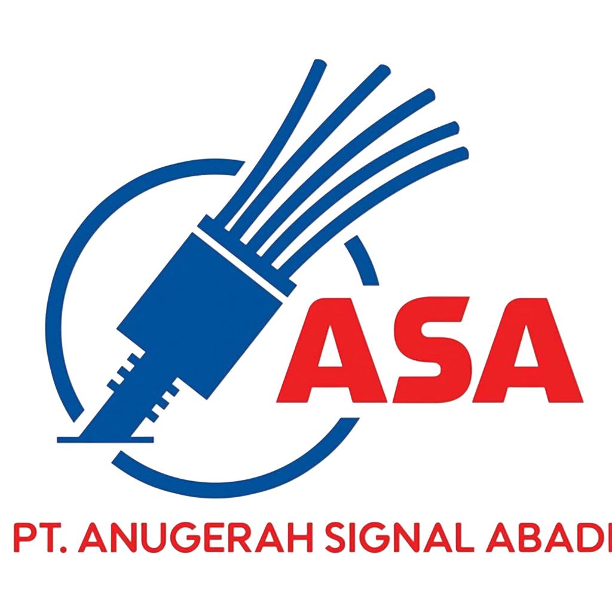

<div align="center">



# ASA Billing

### Sistem Billing dan Operasional ISP

**PT ANUGERAH SIGNAL ABADI**<br>
Platform internal untuk membantu pengelolaan pelanggan, tagihan, pembayaran, dan pengeluaran.

[Website Perusahaan](http://asa-network.my.id/) · [Lokasi Kantor](https://www.google.com/maps/search/?api=1&query=Jl.%20Karya%20Gg.%20Maruto%20No.33%2C%20Karang%20Berombak%2C%20Kec.%20Medan%20Bar.%2C%20Kota%20Medan%2C%20Sumatera%20Utara%2020115)


</div>

---

## Tentang aplikasi

ASA Billing adalah aplikasi web untuk operasional administrasi ISP. Aplikasi dibuat dengan PHP dan MySQL, menggunakan antarmuka SB Admin 2. Integrasi bot WhatsApp berbasis Node.js tersedia sebagai komponen tambahan untuk membantu membaca dan mengelola sebagian data billing.

## Fitur

- **Pelanggan** — melihat, menambah, mengubah, menghapus, serta mengekspor data pelanggan.
- **Omset dan tagihan** — mengelola tagihan, pembayaran, metode pembayaran, dan catatan.
- **Pengeluaran** — mencatat pengeluaran tetap dan pengeluaran tak terduga.
- **Arsip periode** — mengarsipkan data bulanan dan melihat kembali riwayat arsip.
- **Dashboard** — ringkasan pelanggan, omset, tagihan, dan pengeluaran.
- **Akun admin** — akun admin dengan izin create, update, dan delete serta pencatatan aktivitas.
- **API dan bot WhatsApp** — akses owner untuk beberapa operasi data billing melalui API yang dilindungi token.
- **Ekspor data** — ekspor data yang tersedia ke Excel atau JSON.

> Pembuatan tagihan bulanan otomatis dinonaktifkan. Tagihan baru ditambahkan secara manual; bot pengingat hanya mengirim pengingat untuk tagihan yang sudah tersedia.

## Teknologi

| Komponen | Teknologi |
| --- | --- |
| Aplikasi web | PHP |
| Database | MySQL / MariaDB |
| Antarmuka | SB Admin 2, Bootstrap, jQuery, DataTables |
| Grafik dan ekspor | Chart.js, helper ekspor PHP |
| Bot opsional | Node.js 18+, Baileys |

## Struktur proyek

```text
.
├── dashboard.php                 # Ringkasan operasional
├── tables.php                    # Daftar pelanggan
├── omset.php                     # Tagihan, pembayaran, dan metode pembayaran
├── pengeluaran_tetap.php         # Pengeluaran tetap
├── pengeluaran_takterduga.php    # Pengeluaran tak terduga
├── database.php                  # Tutup periode dan riwayat arsip bulanan
├── admins.php                    # Pengelolaan akun admin
├── admin_activity.php            # Riwayat aktivitas admin
├── bot_api.php                   # API billing untuk integrasi bot
├── tambah_*.php                  # Operasi tambah data
├── ubah_*.php                    # Operasi ubah data
├── hapus*.php                    # Operasi hapus data
├── export_*.php                  # Ekspor pelanggan dan keuangan
├── auth.php                      # Autentikasi, izin, dan pencatatan aktivitas
├── admin_helpers.php             # Helper autentikasi dan administrasi
├── img/AnugerahSignalAbadi.png   # Logo perusahaan
├── vendor/                       # Library frontend yang disertakan
└── src/                          # Bot WhatsApp Node.js
    ├── commands/                 # Perintah bot
    ├── handlers/                 # Pemrosesan pesan
    ├── utils/                    # Utilitas dan integrasi billing
    └── database/                 # Data runtime lokal; jangan commit sesi/token
```

## Menjalankan aplikasi web

### Persyaratan

- PHP dengan ekstensi `mysqli`, `PDO MySQL`, dan `mysqlnd`
- MySQL atau MariaDB
- Apache atau web server PHP lain
- Browser modern

### Langkah pemasangan

1. Salin atau clone repository ke direktori web server.
2. Buat database MySQL bernama `billing_asa` atau sesuaikan nama database di konfigurasi.
3. Siapkan skema tabel aplikasi dari sumber database/backup resmi yang digunakan oleh instalasi Anda.
4. Atur host, nama database, username, dan password database pada konfigurasi koneksi PHP sebelum aplikasi dijalankan.
5. Arahkan document root web server ke direktori proyek, lalu buka halaman `login.php`.

Sebagian halaman PHP membuat koneksi `mysqli` secara langsung, sedangkan [`koneksi.php`](koneksi.php) menyediakan koneksi PDO. Pastikan konfigurasi koneksinya konsisten dan gunakan akun database khusus aplikasi dengan hak akses minimum yang diperlukan.

> **Penting:** `import_datapelanggan_oct26.sql` adalah data impor pelanggan, bukan file pembuatan skema. File tersebut menambahkan data dan hanya boleh digunakan setelah backup serta setelah memastikan tabel pelanggan masih kosong.

### Login dan akun admin

- Admin utama menggunakan akun MySQL yang dikonfigurasi untuk autentikasi pada `login.php`.
- Akun admin aplikasi dikelola melalui halaman **Admins** setelah login sebagai admin utama.
- Berikan izin hanya sesuai tugas pengguna. Akun admin non-utama yang tidak aktif tidak dapat login.

## Menjalankan bot WhatsApp (opsional)

Bot memerlukan Node.js versi 18 atau lebih baru dan akun WhatsApp yang akan ditautkan.

```bash
npm install
npm start
```

Atur nomor owner, prefix, dan pilihan bot di [`src/config.js`](src/config.js). Saat pertama kali dijalankan, ikuti instruksi pairing yang ditampilkan dan tautkan perangkat melalui WhatsApp.

### Menghubungkan bot dengan API billing

1. Pastikan `bot_api.php` dapat diakses melalui **HTTPS**.
2. Buat token API acak yang kuat dan simpan token di konfigurasi environment server PHP sebagai `BILLING_BOT_API_TOKEN`.
3. Simpan URL API dan token yang sama di environment bot:

   ```dotenv
   BILLING_API_URL=https://domain-anda/bot_api.php
   BILLING_API_TOKEN=ganti-dengan-token-acak-yang-kuat
   BILLING_REMINDER_TIMEZONE=Asia/Jakarta
   ```

4. Jangan masukkan token asli ke Git, README, atau pesan publik. Batasi penggunaan API kepada owner sesuai konfigurasi dan dokumentasi perintah bot.

API menyediakan operasi untuk data pelanggan, tagihan/omset, pengeluaran, serta pengingat sesuai endpoint dan validasi yang tersedia di `bot_api.php`. Pengelolaan akun admin dan tutup/arsip periode dilakukan melalui aplikasi web, bukan melalui WhatsApp.

## Penggunaan arsip periode

Halaman **Database** menyalin data ke arsip saat periode ditutup. Sesuai alur aplikasi:

- Data arsip tetap tersimpan sebagai riwayat.
- Tagihan belum lunas atau cicilan tetap berada di Omset.
- Tagihan yang sudah lunas dihapus dari Omset aktif setelah diarsipkan.
- Data pengeluaran aktif dikosongkan setelah disalin ke arsip.

Periksa periode dan data arsip dengan teliti sebelum menutup periode. Buat backup database terlebih dahulu; jangan menghapus arsip jika masih diperlukan untuk pemulihan.

## Keamanan dan backup

- Gunakan HTTPS untuk website dan API.
- Jangan commit password database, token API, file `.env`, sesi WhatsApp, atau data runtime.
- Gunakan password unik dan akun database non-root untuk aplikasi.
- Batasi akses server dan panel database hanya kepada personel berwenang.
- Jadwalkan backup database serta uji proses pemulihan secara berkala.
- Data pelanggan dan informasi pembayaran bersifat rahasia; jangan membagikan dump database atau ekspor kepada pihak yang tidak berwenang.

## Kontribusi

Perubahan dan kontribusi untuk sistem ini dikembangkan bersama **ANUGERAH SIGNAL ABADI (ISP)**. Silakan diskusikan perubahan sebelum menerapkannya pada server operasional, dan uji terlebih dahulu pada lingkungan pengembangan.

<div align="center">

---

**Backend:** Muhammad Angga<br>
[Instagram @anggasayangskibiditoilet](https://www.instagram.com/anggasayangskibiditoilet) · [GitHub @renXTech-sys](https://github.com/renXTech-sys)

*Contribute with ANUGERAH SIGNAL ABADI (ISP)*

[asa-network.my.id](http://asa-network.my.id/) · [Jl. Karya Gg. Maruto No.33, Medan](https://www.google.com/maps/search/?api=1&query=Jl.%20Karya%20Gg.%20Maruto%20No.33%2C%20Karang%20Berombak%2C%20Kec.%20Medan%20Bar.%2C%20Kota%20Medan%2C%20Sumatera%20Utara%2020115)

</div>
